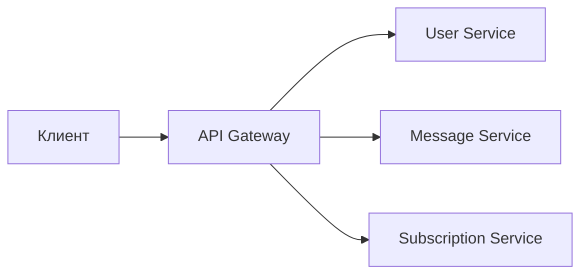
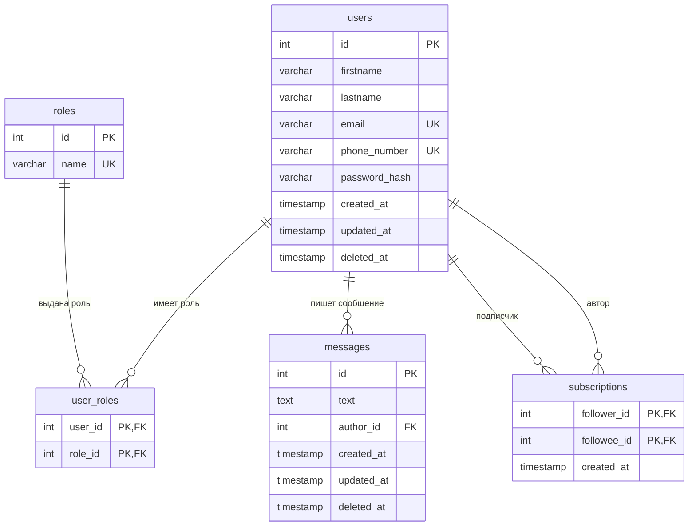

# ЛР 2. Сервисы и API

## Сервисы

Каждый сервис отвечает за свою часть предметной области и работает только со своими таблицами

| Сервис | Отвечает за | Таблицы |
|---|---|---|
| **User Service** | регистрация, вход, профиль, роли | `users`, `roles`, `user_roles` |
| **Message Service** | сообщения и лента | `messages` |
| **Subscription Service** | подписки | `subscriptions` |



API Gateway — единая точка входа: проверяет токен и направляет запрос в нужный сервис

## Схема БД



- `users` ↔ `roles` — многие ко многим через `user_roles`: у пользователя может быть несколько ролей
- `users` → `messages` — один ко многим: у сообщения один автор
- `users` ↔ `users` — многие ко многим через `subscriptions`: обе колонки ссылаются на `users`

## Общие правила API

- Базовый путь — `/api/v1`
- Все запросы, кроме регистрации и входа, передают токен: `Authorization: Bearer <token>`
- Текущий пользователь определяется по токену, а не по `user_id` из тела запроса. Иначе можно действовать от чужого имени
- Коды ответов:

| Код | Когда |
|---|---|
| `200` | успешно, есть тело ответа |
| `201` | ресурс создан |
| `204` | успешно, тела нет |
| `400` | невалидные данные |
| `401` | нет токена или неверный логин/пароль |
| `403` | нет прав на действие |
| `404` | не найдено |
| `409` | конфликт, например email уже занят |

- Формат ошибки:

```json
{ "error": "email_taken", "message": "Email уже занят" }
```

## User Service

| Метод | Путь | Назначение | Успех | Ошибки |
|---|---|---|---|---|
| `POST` | `/auth/register` | регистрация | `201` | `400`, `409` |
| `POST` | `/auth/login` | вход, выдача токена | `200` | `400`, `401` |
| `GET` | `/users/me` | свой профиль | `200` | `401` |
| `PATCH` | `/users/me` | изменить свой профиль | `200` | `400`, `409` |
| `GET` | `/users/{id}` | профиль другого пользователя | `200` | `404` |
| `PUT` | `/users/{id}/roles/{role}` | выдать роль (только `administrator`) | `204` | `403`, `404` |
| `DELETE` | `/users/{id}/roles/{role}` | забрать роль (только `administrator`) | `204` | `403`, `404` |

**Регистрация**

```http
POST /api/v1/auth/register

{
  "firstname": "Мария",
  "lastname": "Орлова",
  "email": "maria.orlova@example.com",
  "phone_number": "+79876543210",
  "password": "secret123"
}
```

```json
201 Created

{
  "id": 3,
  "firstname": "Мария",
  "lastname": "Орлова",
  "email": "maria.orlova@example.com",
  "roles": ["subscriber"]
}
```

Пароль в ответе не возвращается, в БД хранится только его хэш

**Вход**

```http
POST /api/v1/auth/login

{ "email": "maria.orlova@example.com", "password": "secret123" }
```

```json
200 OK

{ "token": "eyJhbGciOiJIUzI1NiIs..." }
```

При неверном email и при неверном пароле ответ одинаковый — `401`, чтобы нельзя было проверить, зарегистрирован ли email

## Message Service

| Метод | Путь | Назначение | Успех | Ошибки |
|---|---|---|---|---|
| `POST` | `/messages` | создать сообщение (роль `producer`) | `201` | `400`, `403` |
| `GET` | `/messages/{id}` | получить сообщение | `200` | `404` |
| `PATCH` | `/messages/{id}` | изменить (только автор) | `200` | `400`, `403`, `404` |
| `DELETE` | `/messages/{id}` | удалить (автор или `administrator`) | `204` | `403`, `404` |
| `GET` | `/users/{id}/messages` | сообщения пользователя | `200` | `404` |
| `GET` | `/feed` | лента: сообщения тех, на кого я подписан | `200` | `401` |

**Создание сообщения**

```http
POST /api/v1/messages

{ "text": "Сегодня вышел новый выпуск" }
```

```json
201 Created

{
  "id": 2,
  "text": "Сегодня вышел новый выпуск",
  "author_id": 2,
  "created_at": "2026-09-24T10:00:00Z"
}
```

Автор берётся из токена, в теле его нет

**Лента** — `GET /api/v1/feed?limit=20&offset=0`

```json
200 OK

{
  "items": [
    {
      "id": 3,
      "text": "Следующий выпуск",
      "author": { "id": 2, "firstname": "Дмитрий", "lastname": "Кузнецов" },
      "created_at": "2026-09-24T11:00:00Z"
    }
  ],
  "limit": 20,
  "offset": 0
}
```

Удаление — soft delete: заполняется `deleted_at`, такие сообщения не попадают в выдачу

## Subscription Service

| Метод | Путь | Назначение | Успех | Ошибки |
|---|---|---|---|---|
| `PUT` | `/users/me/following/{id}` | подписаться | `204` | `400` (на себя), `404` |
| `DELETE` | `/users/me/following/{id}` | отписаться | `204` | — |
| `GET` | `/users/{id}/following` | на кого подписан пользователь | `200` | `404` |
| `GET` | `/users/{id}/followers` | подписчики пользователя | `200` | `404` |

Подписка сделана через `PUT`, а не `POST`: запрос означает «я подписан на пользователя», и повторный вызов ничего не ломает. Поэтому ошибка «уже подписан» не нужна. Отписка по той же логике возвращает `204`, даже если подписки не было

**Подписчики** — `GET /api/v1/users/2/followers`

```json
200 OK

{
  "items": [
    { "id": 1, "firstname": "Анна", "lastname": "Соколова" },
    { "id": 3, "firstname": "Мария", "lastname": "Орлова" }
  ]
}
```
