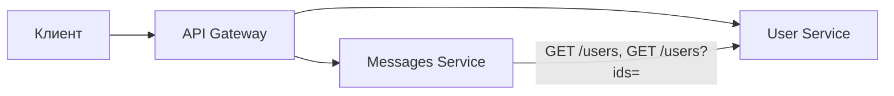
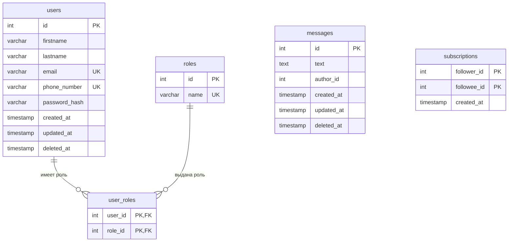

# ЛР 5. Сервисы, API и UML

Копия архитектуры из ЛР 4 с уточнениями для sequence-диаграмм. Оригинал в `lr_4/` не менялся.

## Сервисы

Каждый сервис отвечает за свою часть предметной области и работает только со своими таблицами


| Сервис               | Отвечает за                      | Таблицы                        |
| -------------------- | -------------------------------- | ------------------------------ |
| **User Service**     | регистрация, вход, профиль, роли | `users`, `roles`, `user_roles` |
| **Messages Service** | сообщения, подписки, лента       | `messages`, `subscriptions`    |





API Gateway - единая точка входа: проверяет подпись и срок JWT и направляет запрос в нужный сервис. В токене: `sub` (id пользователя) и `roles`. Сервисы читают id и роли из токена, отдельный запрос в User Service для проверки роли не нужен.

Messages Service хранит только идентификаторы авторов. Имена для ленты и списков подписок подтягиваются пакетным запросом в User Service (`GET /users?ids=`). При подписке Messages Service проверяет существование пользователя через `GET /users/{id}`.
## Схема БД




- `users` <-> `roles` - многие ко многим через `user_roles`: у пользователя может быть несколько ролей
- Между сервисами нет FK: `author_id`, `follower_id`, `followee_id` - идентификаторы пользователей из User Service
- `subscriptions` - многие ко многим между пользователями: подписчик и автор


## Общие правила API

- Базовый путь - `/api/v1`
- Все запросы, кроме регистрации и входа, передают токен: `Authorization: Bearer <token>`
- Текущий пользователь определяется по токену (`sub`), а не по `user_id` из тела запроса. Иначе можно действовать от чужого имени
- Роли для авторизации действий (например `producer` при создании сообщения) берутся из claim `roles` в JWT
- Коды ответов:


| Код   | Когда                                |
| ----- | ------------------------------------ |
| `200` | успешно, есть тело ответа            |
| `201` | ресурс создан                        |
| `204` | успешно, тела нет                    |
| `400` | невалидные данные                    |
| `401` | нет токена или неверный логин/пароль |
| `403` | нет прав на действие                 |
| `404` | не найдено                           |
| `409` | конфликт, например email уже занят   |


- Формат ошибки:

```json
{ "error": "email_taken", "message": "Email уже занят" }
```


## User Service


| Метод    | Путь                       | Назначение                                    | Успех | Ошибки       |
| -------- | -------------------------- | --------------------------------------------- | ----- | ------------ |
| `POST`   | `/auth/register`           | регистрация                                   | `201` | `400`, `409` |
| `POST`   | `/auth/login`              | вход, выдача токена                           | `200` | `400`, `401` |
| `GET`    | `/users/me`                | свой профиль                                  | `200` | `401`        |
| `PATCH`  | `/users/me`                | изменить свой профиль                         | `200` | `400`, `409` |
| `GET`    | `/users/{id}`              | профиль другого пользователя                  | `200` | `404`        |
| `GET`    | `/users?ids=1,2`           | пакетное получение профилей (имена для ленты) | `200` | `400`        |
| `PUT`    | `/users/{id}/roles/{role}` | выдать роль (только `administrator`)          | `204` | `403`, `404` |
| `DELETE` | `/users/{id}/roles/{role}` | забрать роль (только `administrator`)         | `204` | `403`, `404` |


**Регистрация**

```http
POST /api/v1/auth/register

{
  "firstname": "Мария",
  "lastname": "Орлова",
  "email": "maria.orlova@example.com",
  "phone_number": "+79876543210",
  "password": "secret123"
}
```

```json
201 Created

{
  "id": 3,
  "firstname": "Мария",
  "lastname": "Орлова",
  "email": "maria.orlova@example.com",
  "roles": ["subscriber"]
}
```

Пароль в ответе не возвращается, в БД хранится только его хэш. Регистрация выполняется в одной транзакции: `INSERT` в `users` и выдача роли `subscriber` в `user_roles`

**Вход**

```http
POST /api/v1/auth/login

{ "email": "maria.orlova@example.com", "password": "secret123" }
```

```json
200 OK

{ "token": "eyJhbGciOiJIUzI1NiIs..." }
```

При неверном email и при неверном пароле ответ одинаковый - `401`, чтобы нельзя было проверить, зарегистрирован ли email. В JWT кладутся `sub` (id) и `roles` пользователя
**Пакетное получение** - `GET /api/v1/users?ids=2,3`

```json
200 OK

{
  "items": [
    { "id": 2, "firstname": "Дмитрий", "lastname": "Кузнецов" },
    { "id": 3, "firstname": "Мария", "lastname": "Орлова" }
  ]
}
```


## Messages Service


| Метод    | Путь                       | Назначение                               | Успех | Ошибки                 |
| -------- | -------------------------- | ---------------------------------------- | ----- | ---------------------- |
| `POST`   | `/messages`                | создать сообщение (роль `producer`)      | `201` | `400`, `403`           |
| `GET`    | `/messages/{id}`           | получить сообщение                       | `200` | `404`                  |
| `PATCH`  | `/messages/{id}`           | изменить (только автор)                  | `200` | `400`, `403`, `404`    |
| `DELETE` | `/messages/{id}`           | удалить (автор или `administrator`)      | `204` | `403`, `404`           |
| `GET`    | `/users/{id}/messages`     | сообщения пользователя                   | `200` | `404`                  |
| `PUT`    | `/users/me/following/{id}` | подписаться                              | `204` | `400` (на себя), `404` |
| `DELETE` | `/users/me/following/{id}` | отписаться                               | `204` | -                      |
| `GET`    | `/users/{id}/following`    | на кого подписан пользователь            | `200` | `404`                  |
| `GET`    | `/users/{id}/followers`    | подписчики пользователя                  | `200` | `404`                  |
| `GET`    | `/feed`                    | лента: сообщения тех, на кого я подписан | `200` | `401`                  |


**Создание сообщения**

```http
POST /api/v1/messages

{ "text": "Сегодня вышел новый выпуск" }
```

```json
201 Created

{
  "id": 2,
  "text": "Сегодня вышел новый выпуск",
  "author_id": 2,
  "created_at": "2026-09-24T10:00:00Z"
}
```

Автор берётся из токена (`sub`), в теле его нет. Роль `producer` проверяется по claim `roles` в токене: отдельного запроса в User Service нет. Нет роли - `403`. Пустой или невалидный текст - `400`

Удаление - soft delete: заполняется `deleted_at`, такие сообщения не попадают в выдачу

Подписка сделана через `PUT`, а не `POST`: запрос означает «я подписан на пользователя», и повторный вызов ничего не ломает. Поэтому ошибка «уже подписан» не нужна. Отписка по той же логике возвращает `204`, даже если подписки не было

Порядок проверки при `PUT /users/me/following/{id}`:

1. Gateway: нет или битый токен - `401`
2. `id` совпадает с текущим пользователем - `400` (на себя нельзя)
3. Messages Service вызывает `GET /users/{id}` в User Service: пользователя нет - `404`
4. `INSERT ... ON CONFLICT DO NOTHING` - `204`
**Подписчики** - `GET /api/v1/users/2/followers`

```json
200 OK

{
  "items": [
    { "id": 1, "firstname": "Анна", "lastname": "Соколова" },
    { "id": 3, "firstname": "Мария", "lastname": "Орлова" }
  ]
}
```

Имена берутся пакетным запросом в User Service по списку `follower_id` / `followee_id`

**Лента** - `GET /api/v1/feed?limit=20&offset=0`

```json
200 OK

{
  "items": [
    {
      "id": 3,
      "text": "Следующий выпуск",
      "author": { "id": 2, "firstname": "Дмитрий", "lastname": "Кузнецов" },
      "created_at": "2026-09-24T11:00:00Z"
    }
  ],
  "limit": 20,
  "offset": 0
}
```


### Как строится лента

Лента читается одним запросом: `JOIN subscriptions + messages` по текущему пользователю, фильтр `deleted_at IS NULL`, сортировка `created_at DESC`, пагинация `limit` / `offset`. Индекс `(author_id, created_at DESC)` ускоряет выборку сообщений авторов из подписок

```sql
SELECT m.id, m.author_id, m.text, m.created_at
FROM   subscriptions s
JOIN   messages m ON m.author_id = s.followee_id
WHERE  s.follower_id = ?
  AND  m.deleted_at IS NULL
ORDER  BY m.created_at DESC, m.id DESC
LIMIT  ? OFFSET ?;
```

Объект `author` в ответе собирается после пакетного запроса в User Service по списку `author_id` из результата