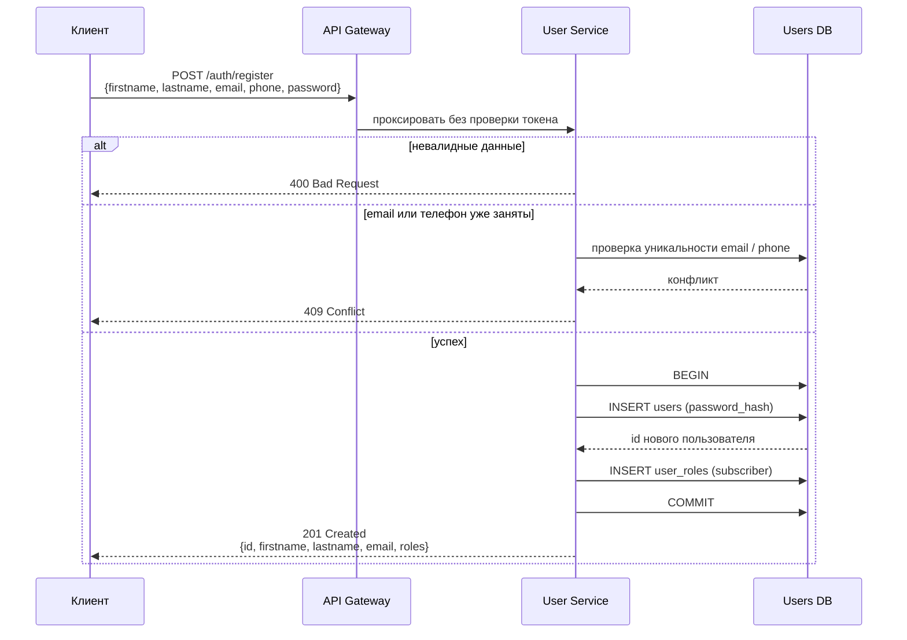
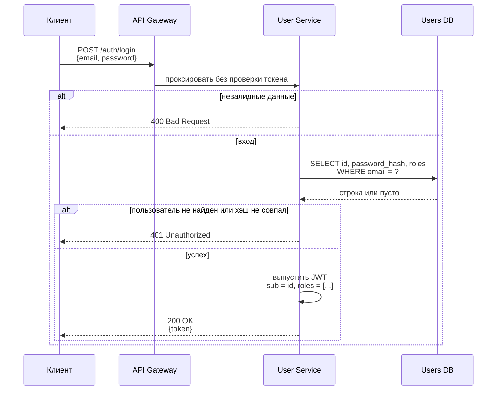
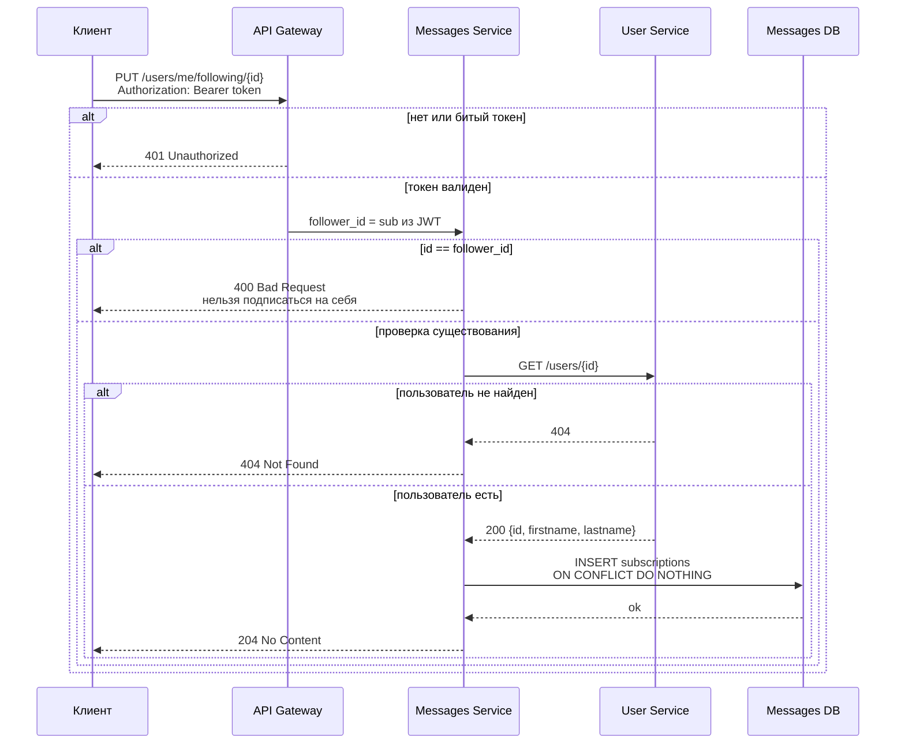
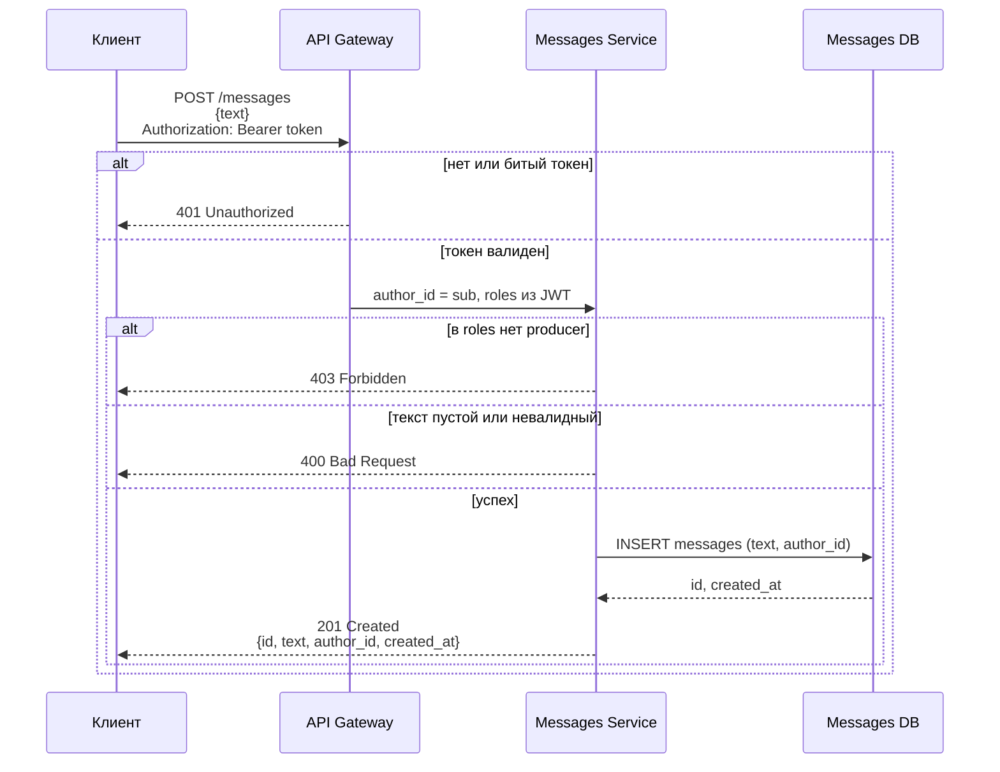
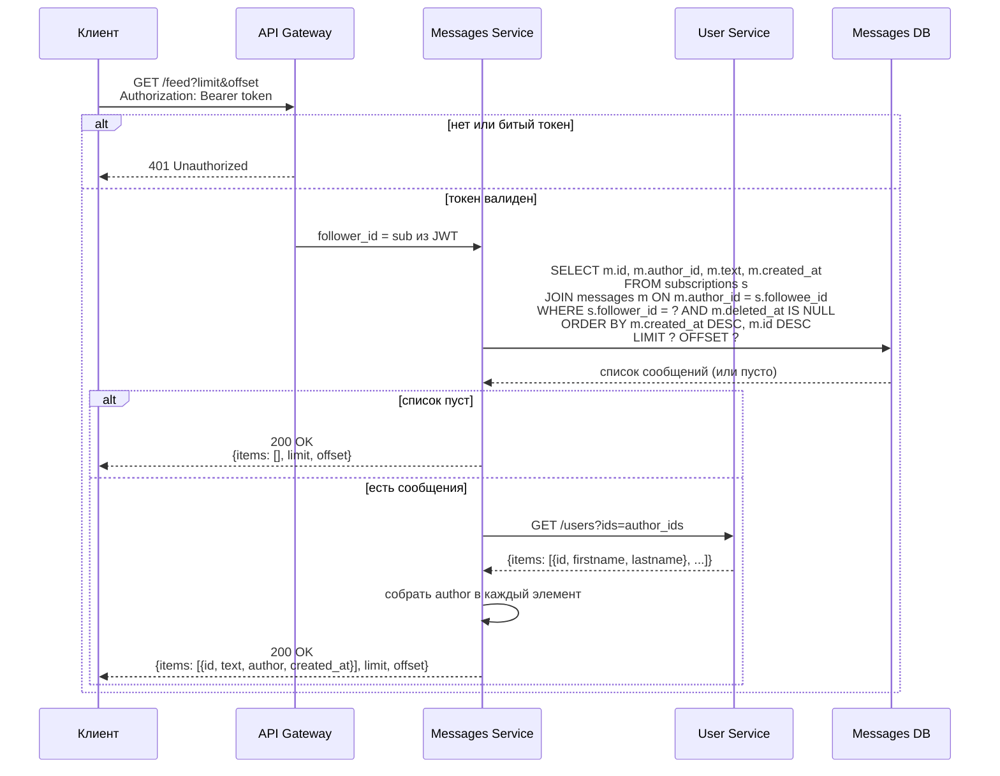
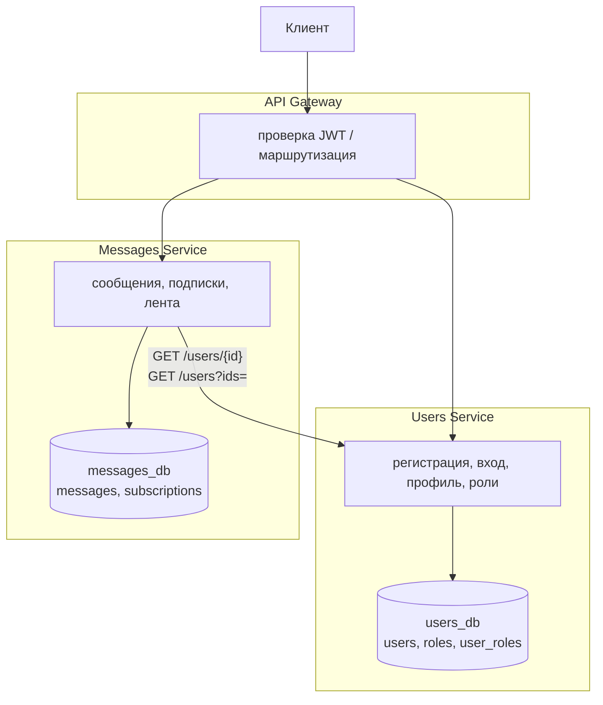

# ЛР 5. UML

## 1. Регистрация (User Service)

`POST /api/v1/auth/register` - токен не нужен

Пароль в ответе не возвращается. Роль по умолчанию - `subscriber`

---

## 2. Вход (User Service)

`POST /api/v1/auth/login` - токен не нужен. Неверный email и неверный пароль дают одинаковый `401`

---

## 3. Подписка (Messages Service)

`PUT /api/v1/users/me/following/{id}` - нужен токен. Идемпотентно: повторный вызов тоже `204`

---

## 4. Создание сообщения (Messages Service)

`POST /api/v1/messages` - нужен токен и роль `producer` в JWT. `author_id` берется из `sub`, в теле его нет

Отдельный запрос в User Service для проверки роли не выполняется: роль уже в токене

---

## 5. Получение ленты (Messages Service)

`GET /api/v1/feed?limit=20&offset=0` - нужен токен. Имена авторов - пакетный запрос в User Service

## 6. Архитектура микросервисов

Два сервиса: **users** и **messages**. Подписки, сообщения и лента живут в messages.

### Границы сервисов

| Сервис | Отвечает за | Таблицы | Ключевые эндпоинты |
| --- | --- | --- | --- |
| **Users** | регистрация, вход, профиль, роли | `users`, `roles`, `user_roles` | `/auth/register`, `/auth/login`, `/users/...` |
| **Messages** | сообщения, подписки, лента | `messages`, `subscriptions` | `/messages`, `/users/me/following/{id}`, `/feed` |

### Взаимодействие

- Клиент ходит только в API Gateway.
- Между сервисами нет FK: в messages хранятся только id пользователей (`author_id`, `follower_id`, `followee_id`).
- Messages обращается в Users за именами и проверкой существования пользователя.
- Лента строится в Messages: `JOIN subscriptions + messages`, затем пакетный `GET /users?ids=` для объекта `author`.
